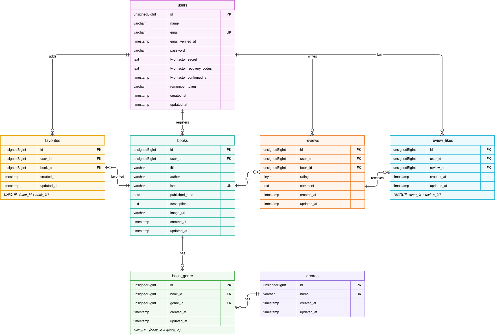

# BookShelf 書籍レビューアプリ

## 概要

本を登録して、みんなでレビューし合う書籍レビューアプリです。書籍の登録・管理、ジャンルによる分類、レビューの投稿、お気に入り、レビューへのいいね、評価ランキング、外部から書籍情報を扱える公開 API を備えています。

### 機能一覧（基本機能）

| 分類 | 機能 |
|---|---|
| 認証 | 会員登録、ログイン、ログアウト（Laravel Fortify） |
| 書籍 | 一覧（10件ずつのページネーション・平均評価つき）、詳細、登録、編集、削除 |
| ジャンル | 一覧、詳細（そのジャンルの書籍一覧）、登録、編集、削除 |
| レビュー | 投稿、編集、削除（評価 1〜5 とコメント） |
| お気に入り | 書籍の追加・解除、お気に入り一覧 |
| いいね | レビューへのいいね・取り消し |
| ランキング | 平均評価の高い書籍 TOP 10 |
| 公開 API | 書籍の一覧・詳細・登録・更新・削除（認証なし） |

主なルール:

- ログインしていないゲストが見られるのは、書籍一覧、書籍詳細（レビュー・いいね数を含む）、評価ランキングです。書籍の登録・編集・削除、レビューの投稿・編集・削除、お気に入り、いいね、ジャンルの画面は、ログインが必要です（未ログインでアクセスするとログイン画面に移動します）。
- 書籍・レビューの編集と削除は、登録した本人だけができます（他のユーザーは 403）。
- 書籍には複数のジャンルを付けられます。書籍が紐付いているジャンルは削除できません。
- 同じ書籍に同じユーザーが複数のレビューを投稿できます。自分のレビューにもいいねできます。
- 書籍を削除すると、その書籍のレビュー（とそのいいね）・お気に入り・ジャンルの紐付けも削除されます。
- 管理者機能はありません。ログインしたユーザーなら誰でもジャンルを操作できます。

## ER 図



## 使用技術

| 区分 | 技術 |
|---|---|
| 言語 | PHP 8.5 |
| フレームワーク | Laravel 10.x |
| データベース | MySQL 8.4 |
| 開発環境 | Laravel Sail（Docker） |
| 認証 | Laravel Fortify |
| フロントエンド | Vite、Tailwind CSS 3.4 |
| DB 管理ツール | phpMyAdmin |

## 開発環境 URL

| 用途 | URL |
|---|---|
| アプリ | http://localhost |
| phpMyAdmin | http://localhost:8080 |

## 環境構築手順

GitHub から clone した直後（`vendor` と `.env` がない状態）から、アプリが動くところまでの手順です。

### 前提

- Docker Desktop（Docker Compose が使えること）
- Git
- 次のポートが空いていること: 80（アプリ）、5173（Vite）、3306（MySQL）、8080（phpMyAdmin）

### 手順

以下のコマンドはすべてプロジェクトのルートディレクトリで実行します。

**1. リポジトリを clone する**

```bash
git clone <リポジトリの URL>
cd <clone したディレクトリ名>
```

**2. Composer で依存パッケージをインストールする**

clone 直後は `vendor` がなく Sail も使えないため、Docker 上の Composer でインストールします。

```bash
docker run --rm \
    -u "$(id -u):$(id -g)" \
    -v "$(pwd):/var/www/html" \
    -w /var/www/html \
    laravelsail/php84-composer:latest \
    composer install --ignore-platform-reqs
```

ローカルに PHP と Composer がある場合は、`composer install` でも構いません。

**3. `.env` を作成する**

```bash
cp .env.example .env
```

`.env.example` の DB 設定は Sail の MySQL コンテナ向けになっているため、そのまま使えます。

**4. Sail を起動する**

```bash
./vendor/bin/sail up -d
```

初回は Docker イメージのビルドに数分かかります。

**5. アプリケーションキーを生成する**

```bash
./vendor/bin/sail artisan key:generate
```

**6. マイグレーションとシーディングを実行する**

```bash
./vendor/bin/sail artisan migrate --seed
```

初回は MySQL の起動に少し時間がかかります。接続エラーになった場合は、数十秒待ってからもう一度実行してください。

**7. フロントエンドをセットアップして Vite を起動する**

```bash
./vendor/bin/sail npm install
./vendor/bin/sail npm run dev
```

`npm run dev` は起動したままにしてください（画面のスタイルの反映に必要です）。

**8. ブラウザで確認する**

http://localhost を開き、下記のログイン情報でログインできれば完了です。

> ヒント: `./vendor/bin/sail` が長い場合は、`alias sail='sh $([ -f sail ] && echo sail || echo vendor/bin/sail)'` を設定すると `sail` だけで実行できます。

### 停止・初期化

```bash
./vendor/bin/sail down                       # 停止
./vendor/bin/sail artisan migrate:fresh --seed   # データベースを初期状態に戻す
```

## 動作確認用ログイン情報

シーディング（`migrate --seed`）で、次の 5 人のユーザーが作成されます。パスワードはすべて `password` です。

| 名前 | メールアドレス | パスワード |
|---|---|---|
| 山田太郎 | yamada@example.com | password |
| 鈴木花子 | suzuki@example.com | password |
| 田中一郎 | tanaka@example.com | password |
| 佐藤美咲 | sato@example.com | password |
| 高橋健太 | takahashi@example.com | password |

あわせて、ジャンル 10 件、書籍 11 冊（登録者は山田太郎）、レビュー 32 件、お気に入り、いいねのサンプルデータも作成されます。

## API エンドポイント一覧

認証は不要です。リクエストに `Accept` ヘッダーがなくても、JSON で応答します。

| メソッド | パス | 概要 |
|---|---|---|
| GET | `/api/v1/books` | 書籍の一覧を取得する（検索・ページネーション対応） |
| GET | `/api/v1/books/{book}` | 書籍の詳細を取得する（レビューを含む） |
| POST | `/api/v1/books` | 書籍を登録する |
| PUT | `/api/v1/books/{book}` | 書籍を更新する（全項目の更新） |
| DELETE | `/api/v1/books/{book}` | 書籍を削除する |

### 一覧の検索条件（クエリパラメータ）

| パラメータ | 内容 |
|---|---|
| `keyword` | タイトルまたは著者の部分一致 |
| `genre_id` | ジャンルの ID で絞り込み |
| `page` | ページ番号（1 以上） |
| `per_page` | 1 ページあたりの件数（1〜100、省略時は 20） |

### ステータスコード

| コード | 内容 |
|---|---|
| 200 | 取得・更新に成功 |
| 201 | 登録に成功 |
| 204 | 削除に成功（レスポンスボディなし） |
| 404 | 書籍が存在しない（`{"message": "書籍が見つかりませんでした。"}`） |
| 422 | 入力内容が不正 |

### リクエスト例

```bash
# タイトルまたは著者に「物語」を含む書籍を 5 件ずつ取得
curl "http://localhost/api/v1/books?keyword=物語&per_page=5"

# 書籍の詳細を取得
curl http://localhost/api/v1/books/1
```

登録・更新のリクエストには、`title`、`author`、`isbn`（半角数字 13 桁）、`published_date`、`genres`（ジャンル ID の配列）、`user_id`（登録者の ID）が必須です。`description` と `image_url` は任意です。

## テスト・コード整形

### Pint（コード整形チェック）

```bash
./vendor/bin/sail bin pint          # 整形を実行
./vendor/bin/sail bin pint --test   # 整形が必要な箇所がないか確認
```

### テスト

```bash
./vendor/bin/sail artisan test
```

（テストの実装後に、内容を追記します）

## 作成者

(太田詠子)
